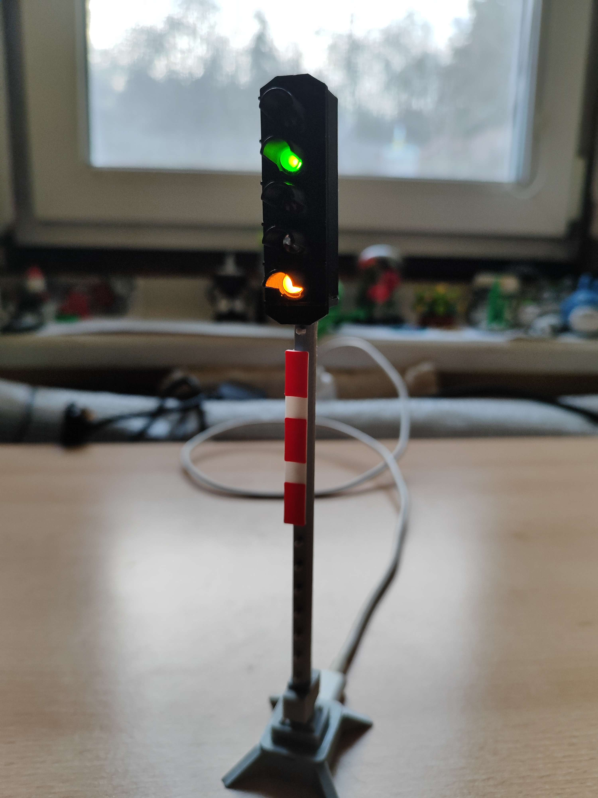
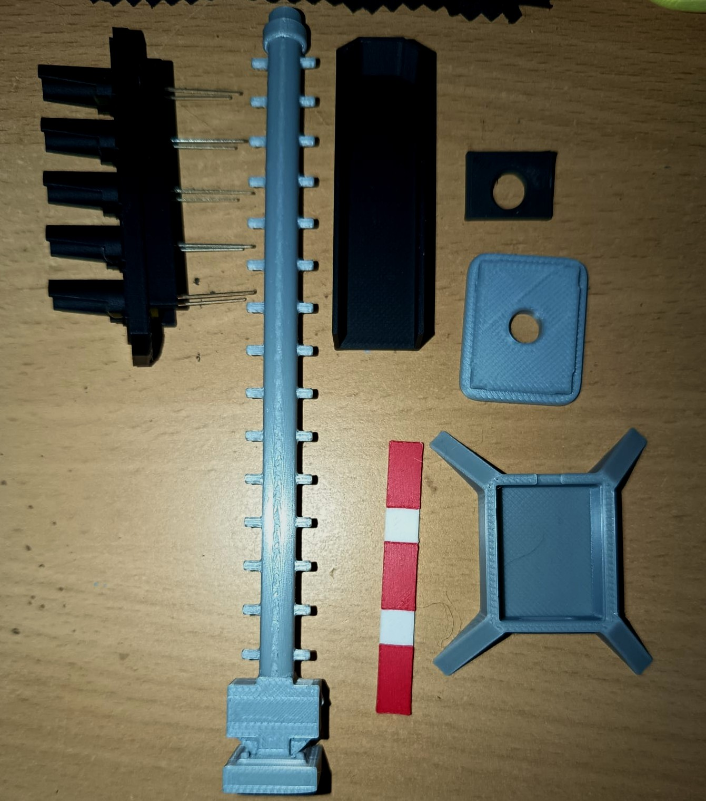
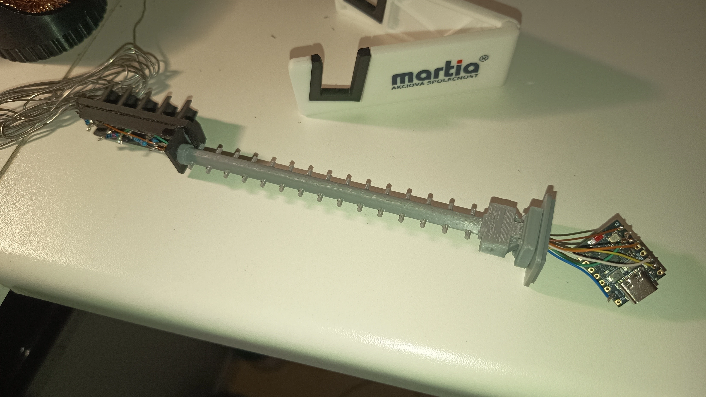
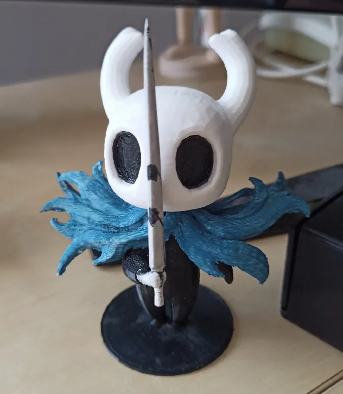
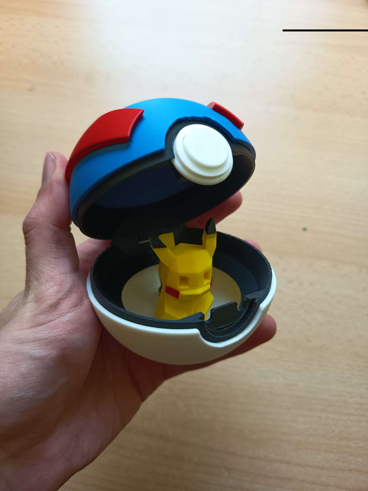
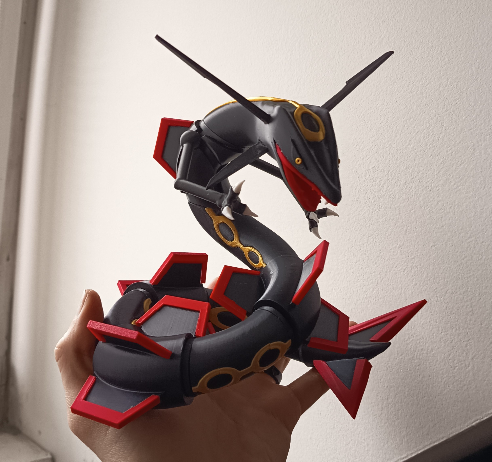
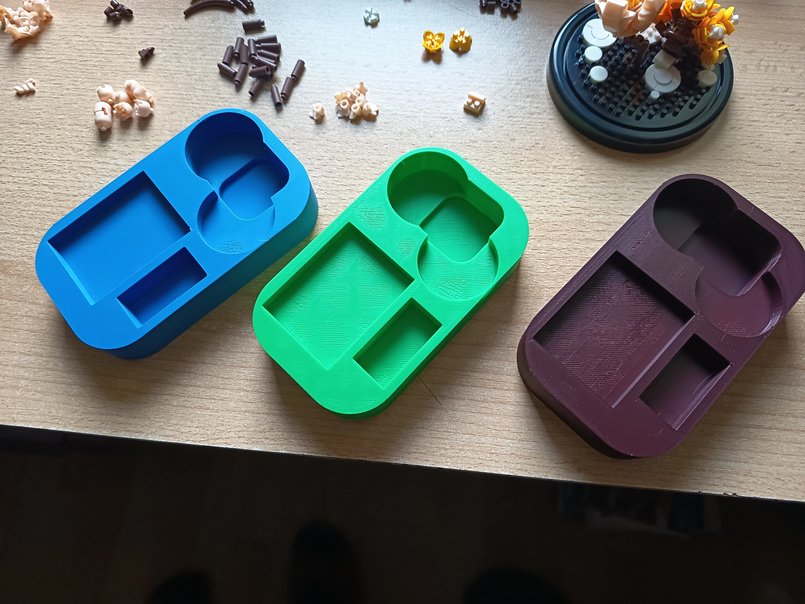
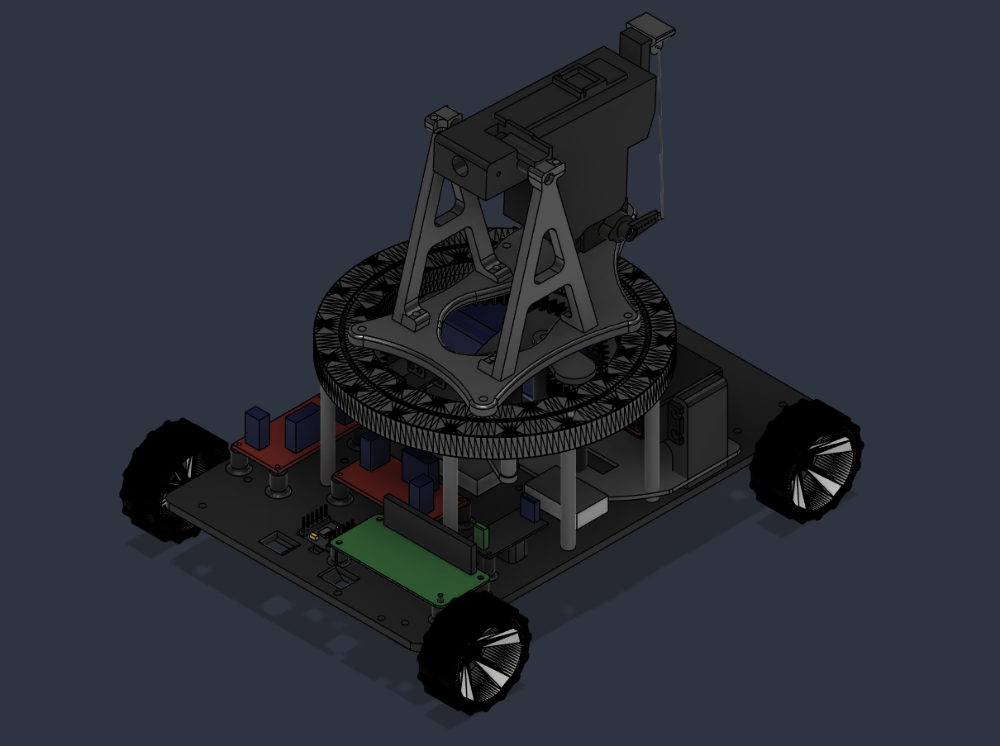
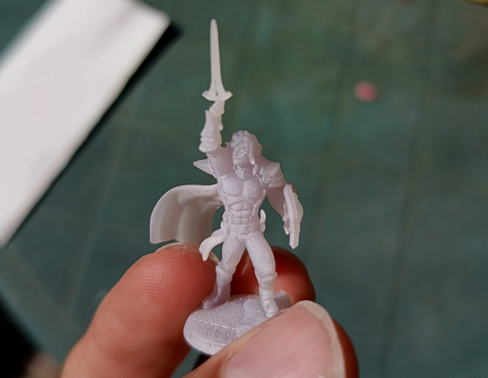

## 3D printers

Durring my 3D carrer I've been ussing totally four 3D printer models:

- BambuLab P1S with AMS
- Prusa MK4
- Two Trees Bluer
- Anycubic Photon Mono _(resin)_

## Interactive Railway Signal

This project started as a custom gift for a train driver. Instead of making a
static model, I decided to build a working railway signal with individually
controlled LEDs and remote operation.

The signal is based on a [public model from
Modelwiki](https://modelwiki.klfree.net/w/index.php/V%C3%BDroba_n%C3%A1v%C4%9Bstidla_A%C5%BDD),
which I adapted in Autodesk Fusion for electronics and assembly. I enlarged
the signal head to make room for the LEDs, closed unused openings, and designed
the rear cover, post, and base from scratch.

_The completed signal with independently illuminated aspects._

### From model to printed parts

The parts were printed on a BambuLab P1S with AMS. The multi-colour setup made
it possible to print the signal housing and coloured details in a single
workflow, although most parts still needed cleanup, fitting, and a small amount
of cyanoacrylate adhesive during assembly.

_All the 3D printed parts prepared for assembly._

### Wiring and electronics

The LED wiring runs through the post in six conductors. Each light in the head
has its own wire and resistor, with a shared ground connection. The wires then
connect to an ESP32-C3 Mini at the base, where the controller manages the
individual signal aspects.

_Complete wiring, connecting LEDs and ESP board._

### Firmware and control

The ESP32-C3 Mini can create its own Wi-Fi network or use a wired connection.
The signal lights can then be **controlled remotely** and configured through saved
presets, giving the model behaviour similar to a **real railway signal**.

The interactive model can be tried at
[navestidlo.kruckyondrej.cz](https://navestidlo.kruckyondrej.cz/).

## Prints gallery

3D printing is one of my favourite ways to turn an idea into something useful
and tangible. I enjoy designing practical parts, experimenting with different
materials and finishes, and refining each print until it works as intended.

| | |
| --- | --- |
|  |  |
| _Hollow Knight figure_ | _Poke Ball_ |
|  |  |
| _Pokemon "Rayquaza" figure_ | _Infills for Pokemón tabletop game_ |
|  | |
| _[Turex](/projects/turex) body parts_ | My first character from resin |

