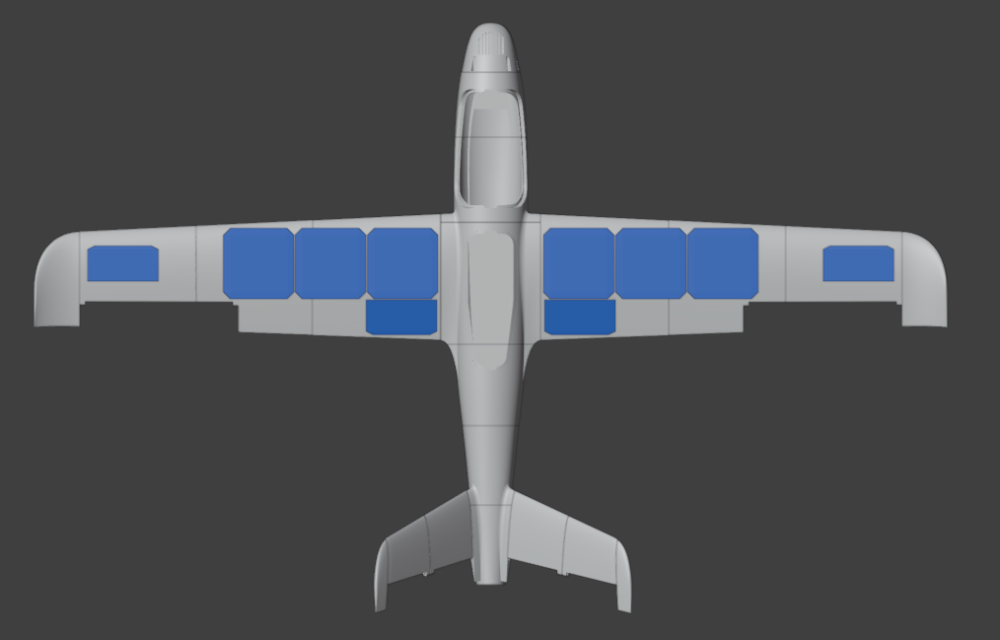

## Overview

Project **Aether** is an academic cyberphysical system and
Edge IoT platform built around an **autonomous solar UAV**. The project explores how
an aircraft can use reinforcement learning to search for thermals, conserve
energy, and make decisions during flight.

The UAV is also designed to act as a flying relay in a **mesh network**, providing
crisis communication and collecting data from IoT devices in areas with limited
connectivity.

## Goals

- Design, implement, and test the software architecture for an autonomous solar
  UAV.
- Use atmospheric data and the current energy state to optimize flight and
  enable autonomous soaring.
- Demonstrate a flying Meshtastic relay for communication and IoT data collection.
- Integrate telemetry and points of interest with ATAK/WinTAK through Cursor on
  Target (CoT).

## Planned architecture

The aircraft will use a 3D-printed LW-ASA glider [Stork](https://flightory.com/product/stork/) from company [Flightory](https://flightory.com/) reinforced with carbon tubes.
An ArduPilot flight controller will handle the low-level flight control, while
a Linux companion computer will run the higher-level software.

The system will combine airspeed, atmospheric pressure, GPS, and energy data.
Communication will use LoRa and Meshtastic, with LoRaWAN considered for wider
IoT data collection.

## Technologies

- Python and MAVSDK for modular asynchronous control software.
- ArduPilot and MAVLink for flight control and telemetry.
- Raspberry Pi or Radxa as the companion computer.
- LoRa, Meshtastic, and mesh networking for communication.
- Reinforcement learning for energy-aware flight decisions.
- BME280, airspeed, GPS, and compass sensors for environmental and navigation
  data.

## Current status

The project is currently in the planning phase. The bill of materials is being
assembled, and the Stork aircraft files have been purchased. The next step is
to finalize the system design and determine how the aircraft, avionics, power
system, and communications hardware will be integrated.

## DevLog

This section contains development notes, experiments, test results, and
lessons learned while building Project Aether.

### 20/10/2026 - Stork files

_Stork plane model with first solar panels placement (Blender)_

For this project, I selected the [Stork](https://flightory.com/product/stork/)
glider from [Flightory](https://flightory.com/) ($29.99). The image above shows
the aircraft model rendered in Blender, along with an initial concept for solar
panel placement. The panels are intended to extend the aircraft's endurance by
providing supplemental power during flight.