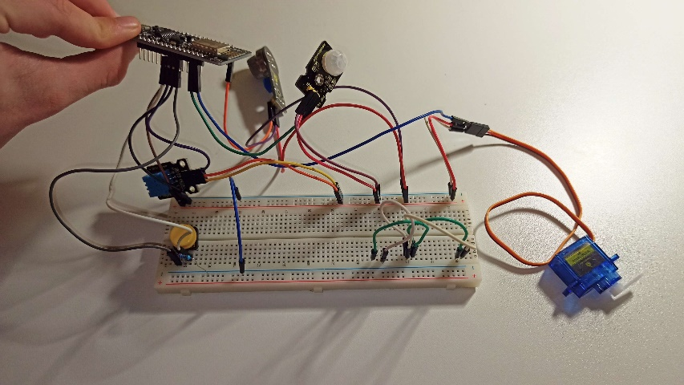
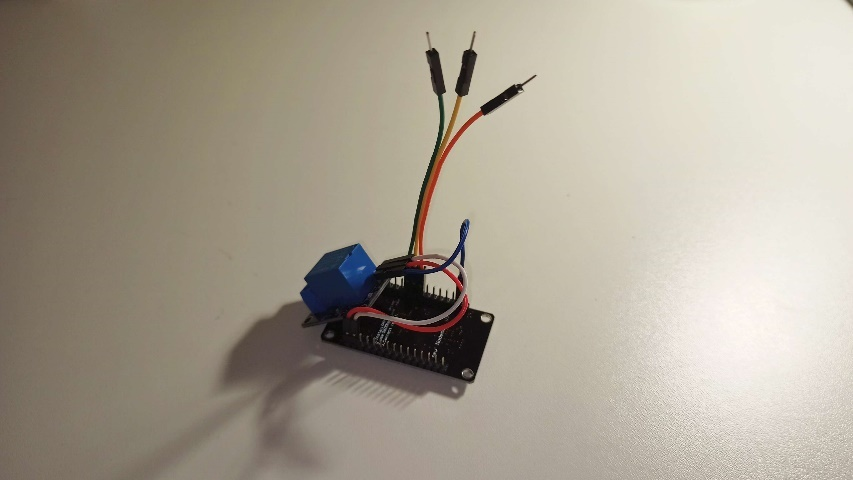
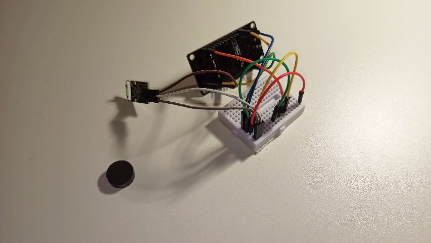
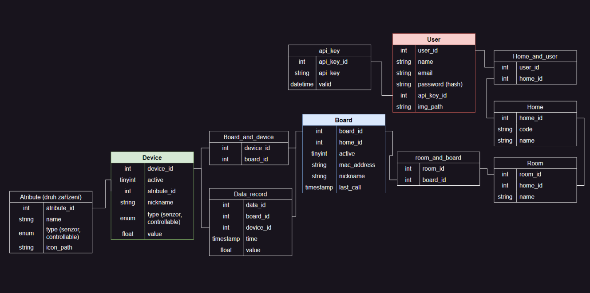

## Overview

**Connect Guardian** is a full-stack IoT platform for connecting sensors and
other devices to a web dashboard. It combines ESP8266 boards, custom hardware,
and a web application into one system for monitoring sensor data and controlling
connected devices.

The project was created as a third-year school project at
[Resslova Secondary School](https://spsul.cz/).

## Technologies

- ESP8266 boards for sensor and device integration.
- React and Vite for the web application.
- Chakra UI for the frontend component library.
- Python and FastAPI for the backend API.
- MariaDB for persistent data storage.
- NAS hosting and network configuration.

## Devices

_ESP #1 with multiple peripherals._

_ESP #2 with a relay module and RGB LED control._

_ESP #3 with a magnetic sensor._

## Dashboard

The dashboard gives users a single place to view the devices they own, inspect
their sensor data, and control connected hardware.

The dashboard used the following technology stack:

- [React](https://react.dev/) with [Vite](https://vite.dev/) for the web application.
- [Chakra UI](https://chakra-ui.com/) for the frontend interface.
- [Python](https://www.python.org/) with [FastAPI](https://fastapi.tiangolo.com/) for the backend API.
- [MariaDB](https://mariadb.org/) for database storage.

## Server & Networking

The project was hosted on a personal NAS. DNS records, NAT, and a public IP
address routed external traffic to the services running on the device.

## Database

The database stored users and their credentials, JWT tokens, homes, boards,
and connected devices.

A separate `data_record` table stored historical sensor readings for display as
charts in the user dashboard.

### Schema

