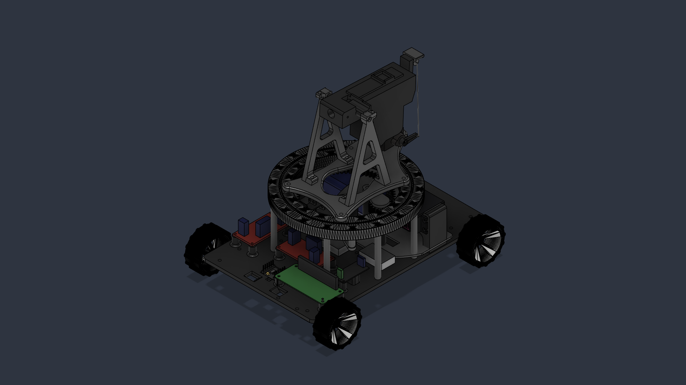
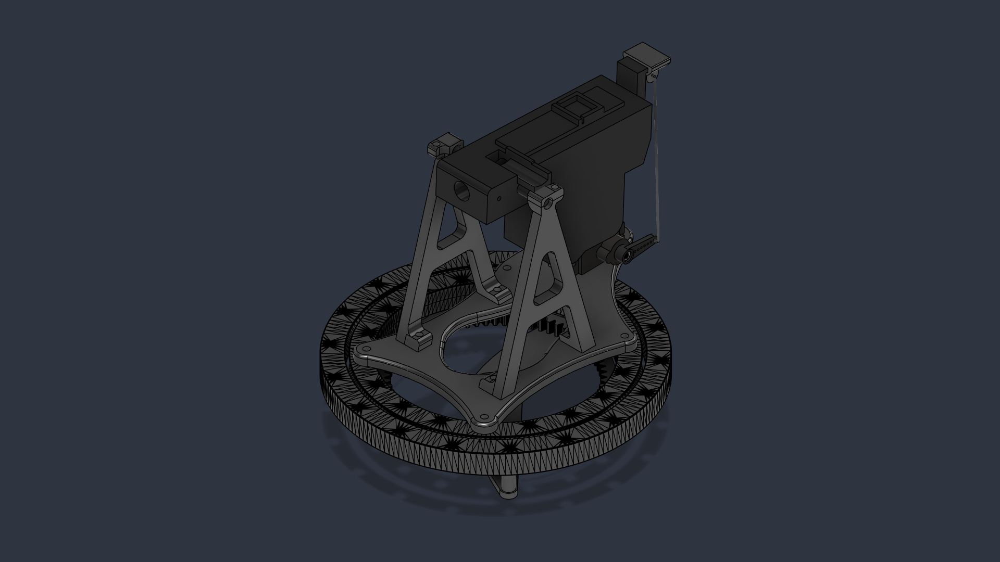
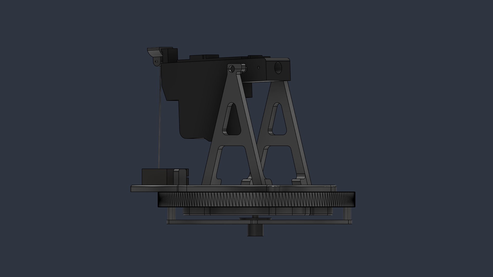

## Overview

**Turex** is a completed remote-controlled combat robot built
around a Raspberry Pi and an omnidirectional Mecanum drive. It combines custom
mechanics, electronics, and asynchronous Python software in one compact
cyberphysical system.

The robot can move in any direction, aim with a continuously rotating turret,
and control a Taigen BB firing mechanism. Its hardware and software were
designed with reliable parallel operation and protection against motor and
servo power spikes in mind.

## Key features

- Four-wheel omnidirectional movement using Mecanum wheels and dual DRV8833
  motor drivers.
- Continuous 360-degree turret rotation through a 12-channel slip ring.
- Pan and tilt control with MG996R and MG90S servos.
- Active Taigen BB firing mechanism with MOSFET switching and end-stop feedback.
- Non-blocking control of driving, aiming, firing, and auxiliary systems with
  Python `asyncio`.
- Custom 3D-printed chassis with modular mounts and integrated power switches.

## Hardware architecture

The robot uses a 2S Li-ion battery pack and three separate power
paths. This prevents high-current motors and firing or servo loads from causing
unstable voltage on the Raspberry Pi.

The main hardware components are:

- Raspberry Pi as the main controller.
- Two DRV8833 dual H-bridge motor drivers for the four Mecanum wheels.
- Two XL4015 buck converters for isolated 5 V logic and actuator rails.
- 12-channel slip ring for continuous turret rotation.
- Taigen airsoft mechanism with an end-stop sensor.
- MG996R pan servo and MG90S tilt servo.
- IRF520 or AOD4184 MOSFET module for firing control.

## Software architecture

The control software is written in Python and uses `asyncio` with `gpiozero` to
run independent hardware tasks without blocking one another. The application is
split into hardware modules for the drivetrain, turret, firing mechanism,
lighting, and input handling.

Remote control is supported through ExpressLRS/CRSF and an Xbox controller.
The main state machine coordinates these inputs with the robot's movement,
targeting, firing, and safety logic.

## Media and assembly

Additional photos of the finished robot and its main subsystems will be added
here later.

_Complete robot assembly with the rotating turret._

_Lower chassis with the Raspberry Pi, motor drivers, and power rails._

_Turret assembly with the slip ring, firing mechanism, and tilt servo._

## Mechanical design

The chassis and mechanical assemblies were designed in **Autodesk Fusion** and
**3D printed** on a BambuLab P1S. The custom PLA chassis uses a rigid baseplate,
modular mounts, and a gyroid infill where appropriate. The upper assembly
integrates the turret bearing, slip ring, firing mechanism, and tilt servo.

## Project structure

| Area | Contents |
| --- | --- |
| `core/` | Main state machine and module coordinator |
| `hardware/` | Drivetrain, turret, firing, and lighting modules |
| `inputs/` | CRSF, ExpressLRS, and Xbox controller input |
| `config.py` | GPIO pin assignments and timing constants |
| `main.py` | Asyncio application entry point |
| `docs/` | Schematics, CAD models, and hardware documentation |
| `media/` | Project photos and demonstration media |

## Result

Turex demonstrates how a Raspberry Pi can coordinate mechanical systems with
different timing and power requirements in a single responsive robot. The
project combines embedded Python, electronics, motor control, remote input, and
3D-printed mechanical design into a finished working platform.
