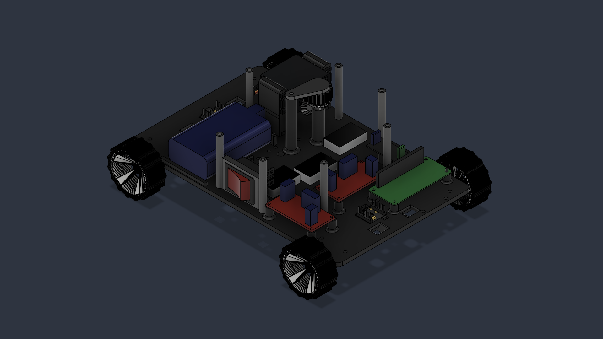
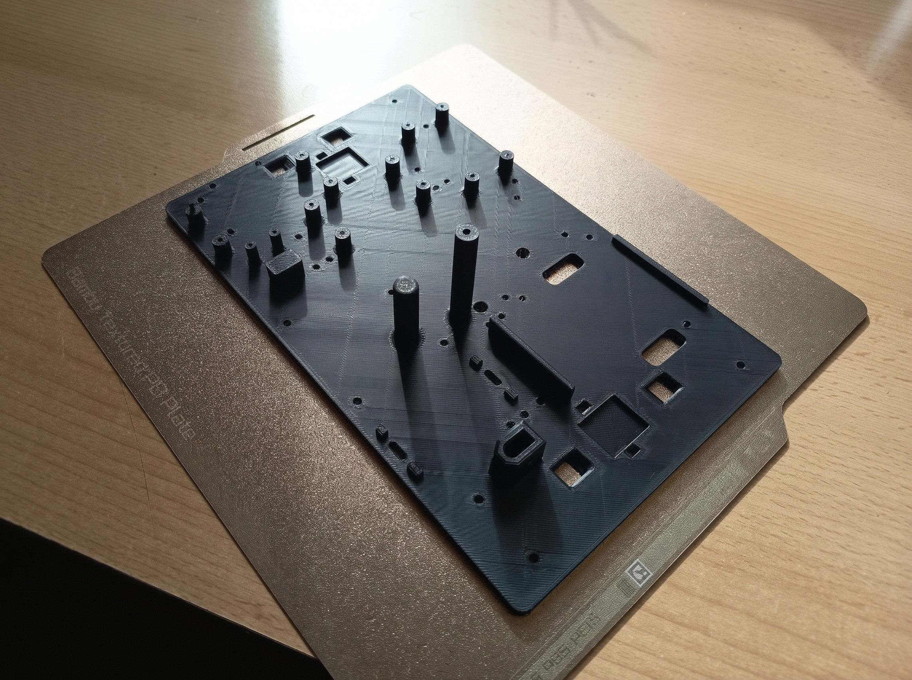
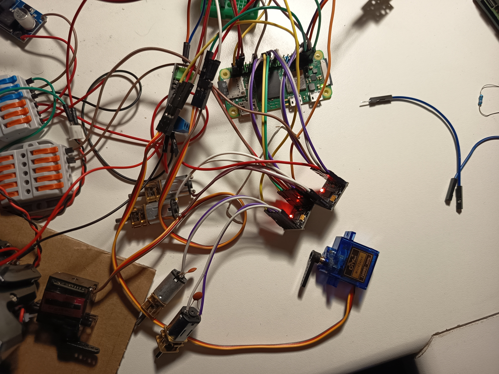
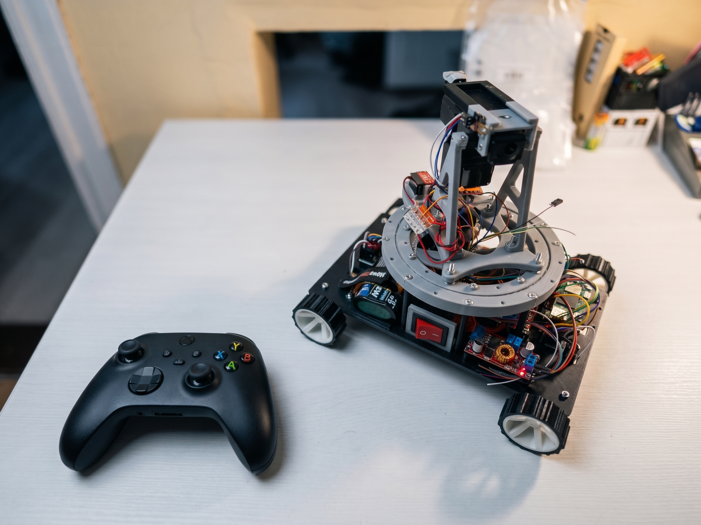

## Overview

**Turex** is a completed remote-controlled combat robot built
around a Raspberry Pi and an omnidirectional Mecanum drive. It combines custom
mechanics, electronics, and asynchronous Python software in one compact
cyberphysical system.

The robot can move in any direction, aim with a continuously rotating turret,
and control a Taigen BB firing mechanism. Its hardware and software were
designed with reliable parallel operation and protection against motor and
servo power spikes in mind.

## Key features

- Four-wheel omnidirectional movement using Mecanum wheels and dual DRV8833
  motor drivers.
- Continuous 360-degree turret rotation through a 12-channel slip ring.
- Pan and tilt control with MG996R and MG90S servos.
- Active Taigen BB firing mechanism with MOSFET switching and end-stop feedback.
- Non-blocking control of driving, aiming, firing, and auxiliary systems with
  Python `asyncio`.
- Custom 3D-printed chassis with modular mounts and integrated power switches.

## Hardware architecture

The robot uses a 2S Li-ion battery pack and three separate power
paths. This prevents high-current motors and firing or servo loads from causing
unstable voltage on the Raspberry Pi.

The main hardware components are:

- Raspberry Pi as the main controller.
- Two DRV8833 dual H-bridge motor drivers for the four Mecanum wheels.
- Two XL4015 buck converters for isolated 5 V logic and actuator rails.
- 12-channel slip ring for continuous turret rotation.
- Taigen airsoft mechanism with an end-stop sensor.
- MG996R pan servo and MG90S tilt servo.
- IRF520 or AOD4184 MOSFET module for firing control.

### Software architecture

The control software is written in Python and uses `asyncio` with `gpiozero` to
run independent hardware tasks without blocking one another. The application is
split into hardware modules for the drivetrain, turret, firing mechanism,
lighting, and input handling.

Remote control is supported through ExpressLRS/CRSF and an Xbox controller.
The main state machine coordinates these inputs with the robot's movement,
targeting, firing, and safety logic.

## Development Process

From initial concepts to a working robotic platform, Turex was built through
mechanical experiments, electronics work, and repeated practical tests. The
three stages below show how separate parts gradually became one system.

### 01 / Mechanical Design & Prototyping

The development started with the mechanical design and gradual construction of
the platform. Custom 3D-printed components allowed individual mechanisms to be
tested, adjusted, and improved before they were integrated into the robot.

_A working prototype exposes the mechanical arrangement and the practical
constraints of fitting the electronics into the printed chassis._

_Turning the CAD design into a real chassis through 3D printing._

CAD · 3D printing · Mechanical design

<!-- Add one representative 3D-print timelapse here when the media file is available. -->

### 02 / Electronics & Hardware Integration

Alongside the mechanical development, the electronic architecture was gradually
assembled. This involved preparing the Raspberry Pi, soldering connections,
configuring power distribution, and integrating the motor drivers and control
components.

_Connection and testing of all the parts before integrating them into the chassis._

Raspberry Pi · Electronics · Power management

<!-- Add the Raspberry Pi soldering photograph -->

### 03 / Testing & System Integration

Individual subsystems were tested progressively before being integrated into the
complete platform. Mechanical movement, motor control, turret operation, firing
feedback, and remote input were verified through repeated practical tests.

_Integration testing verifies that the rotating assembly, slip ring, wiring,
and actuator mounts can operate together._

Testing · Python · System integration

## Software & Technologies

The control software is written in Python and uses `asyncio` with `gpiozero` to
run independent hardware tasks without blocking one another. The application is
split into hardware modules for the drivetrain, turret, firing mechanism,
lighting, and input handling.

The chassis and mechanical assemblies were designed in **Autodesk Fusion** and
**3D printed** on a BambuLab P1S. The custom PLA chassis uses a rigid baseplate,
modular mounts, and a gyroid infill where appropriate.

Python · Raspberry Pi · asyncio · gpiozero · Fusion · 3D printing

## Final build

_Complete robot assembly with the rotating turret. (edited)_

<!-- The final demonstration should show the completed robot operating, ideally with
both Mecanum movement and turret control visible in the same clip. -->

<!-- Add the final robot demonstration video here when the media file is available. -->
